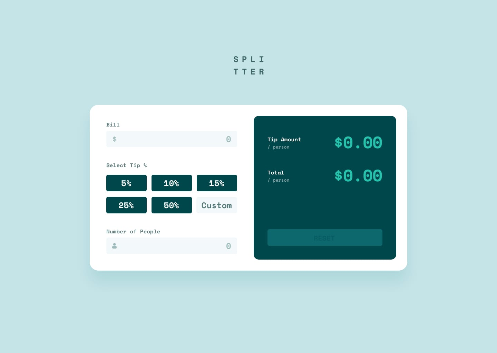
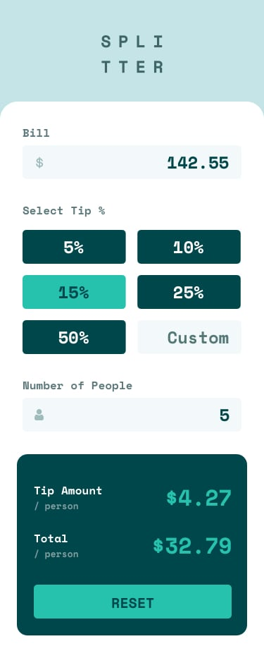

# Frontend Mentor - Solution Tip calculator app (FR)

Ceci est une solution au [challenge Tip calculator app sur Frontend Mentor](https://www.frontendmentor.io/challenges/tip-calculator-app-ugJNGbJUX). Les défis Frontend Mentor vous aident à améliorer vos compétences en codage en réalisant des projets réalistes.

## Table des matières

- [Aperçu](#aperçu)
  - [Le défi](#le-défi)
  - [Captures d'écran](#captures-décran)
  - [Liens](#liens)
- [Mon processus](#mon-processus)
  - [Technologies utilisées](#technologies-utilisées)
  - [Ce que j'ai appris](#ce-que-jai-appris)
  - [Développement continu](#développement-continu)
  - [Ressources utiles](#ressources-utilises)
  - [Collaboration AI](#collaboration-ai)
- [Auteur](#auteur)

---

## Aperçu

### Le défi

Les utilisateurs doivent pouvoir :

- Visualiser la mise en page optimale de l'application en fonction de la taille d'écran de leur appareil.
- Voir les états au survol (hover) et au focus pour tous les éléments interactifs de la page.
- Calculer le montant correct du pourboire et le total de la facture par personne.
- Saisir un pourcentage de pourboire personnalisé via le champ "Custom".
- Obtenir un message d'erreur et une bordure visuelle lorsque le champ du nombre de personnes vaut 0.
- Réinitialiser l'application avec le bouton RESET (activé uniquement lorsque des données sont saisies).

### Captures d'écran

<!-- 
 -->

<p align="center">
  
  
</p>

### Liens

- URL de la solution : [https://github.com/kaina-slimani/tip-calculator-app](https://github.com/kaina-slimani/tip-calculator-app)
- URL du site en direct : [https://kaina-slimani.github.io/tip-calculator-app/](https://kaina-slimani.github.io/tip-calculator-app/)

---

## Mon processus

### Technologies utilisées

- Balisage HTML5 sémantique
- Propriétés personnalisées CSS (Variables)
- Flexbox
- CSS Grid (Workflow Mobile-first)
- JavaScript Vanilla (Manipulation du DOM ES6+ et gestionnaires d'événements)
- Google Fonts - Space Mono

### Ce que j'ai appris

Réaliser ce défi m'a permis de renforcer ma compréhension de la manipulation du DOM, de la gestion des états de l'interface et de la validation des données en JavaScript :

1. **Gestion dynamique des états visuels** : Utiliser `.forEach()` pour réinitialiser la classe `.active` sur un groupe de boutons de pourboire avant de l'appliquer exclusivement au bouton cliqué.
2. **Validation des saisies et sécurité mathématique** : Combiner `parseFloat()` et `parseInt()` avec des vérifications `!isNaN()` pour éviter les erreurs de calcul et l'affichage de valeurs invalides (`NaN$`).
3. **Gestion des erreurs et surcharges d'état** : Afficher dynamiquement le message d'erreur ("Can't be zero") et surcharger le contour au focus standard à l'aide de `input.error:focus`.
4. **Nettoyage automatique de la saisie** : Reformater dynamiquement des valeurs brutes comme `"015"` en `15` pour garantir une expérience utilisateur propre.
5. **Positionnement relatif et absolu** : Placer des icônes vectorielles dans les champs de saisie avec un centrage vertical parfait grâce à `transform: translateY(-50%)`.

```javascript
// Validation du pourboire Custom pour sécuriser les calculs
if (!isNaN(customVal) && customVal >= 0) {
    tipValue = customVal / 100;
} else {
    tipValue = 0.0;
}
```

```css
/* Maintien du contour orange au focus lorsque le champ est en erreur */
input.error:focus {
    outline: 2px solid rgb(228, 119, 17);
}
```

### Développement continu

Pour mes prochains projets, je souhaite approfondir la structuration des composants interactifs, améliorer l'accessibilité web (WCAG) pour les formulaires HTML et affiner les modèles de gestion d'état.


### Ressources utiles

  - [MDN Web Docs - Array.prototype.forEach()](https://developer.mozilla.org/fr/docs/Web/JavaScript/Reference/Global_Objects/Array/forEach) - Guide essentiel pour parcourir les boutons afin de basculer les classes d'état.
  - [MDN Web Docs - HTMLInputElement](https://developer.mozilla.org/fr/docs/Web/API/HTMLInputElement) - Ressource utile pour comprendre les événements de saisie numérique et les propriétés de validation.

### Collaboration AI

- Outils utilisés : Gemini (Google AI) comme mentor interactif en développement web.

- Workflow & Méthodologie : Approche pas-à-pas pour analyser les concepts théoriques (écouteurs d'événements, gestion d'état, états focus CSS et parsing des entrées) avant l'écriture du code.

- Résultats : A permis de clarifier les différences entre .classList.add(), .remove() et .toggle(), de résoudre des cas limites (gestion de la valeur 0 et conversions de chaînes comme "015"), et de structurer des commentaires bilingues dans les fichiers sources.

## Auteur

- Frontend Mentor - [@kaina-slimani](https://www.frontendmentor.io/profile/kaina-slimani)
- GitHub - [@kaina-slimani](https://github.com/kaina-slimani)
- LinkedIn - Kaïna Slimani [@kaina-slimani](https://www.linkedin.com/in/kaina-slimani/)


------------------------------------------------------------

# Frontend Mentor - Tip calculator app solution (EN)

This is a solution to the [Tip calculator app challenge on Frontend Mentor](https://www.frontendmentor.io/challenges/tip-calculator-app-ugJNGbJUX). Frontend Mentor challenges help you improve your coding skills by building realistic projects.

## Table of contents

- [Overview](#overview)
  - [The challenge](#the-challenge)
  - [Screenshots](#screenshots)
  - [Links](#links)
- [My process](#my-process)
  - [Built with](#built-with)
  - [What I learned](#what-i-learned)
  - [Continued development](#continued-development)
  - [Useful resources](#useful-resources)
  - [AI Collaboration](#ai-collaboration)
- [Author](#author)

---

## Overview

### The challenge

Users should be able to:

- View the optimal layout for the app depending on their device's screen size
- See hover and focus states for all interactive elements on the page
- Calculate the correct tip and total cost of the bill per person
- Enter a custom tip percentage using the "Custom" input field
- See an error message and visual outline when the number of people input is 0
- Reset the app using the RESET button (enabled only when inputs or tip selections are present)

### Screenshots

<!-- 
 -->

<p align="center">
  
  
</p>

### Links

- Solution URL: [https://github.com/kaina-slimani/tip-calculator-app](https://github.com/kaina-slimani/tip-calculator-app)
- Live Site URL: [https://kaina-slimani.github.io/tip-calculator-app/](https://kaina-slimani.github.io/tip-calculator-app/)

---

## My process

### Built with

- Semantic HTML5 markup
- CSS custom properties (Variables)
- Flexbox
- CSS Grid (Mobile-first workflow)
- Vanilla JavaScript (ES6+ DOM manipulation and event handling)
- Google Fonts - Space Mono

### What I learned

Working through this challenge strengthened my understanding of DOM manipulation, UI state management, and input validation in JavaScript:

1. **Dynamic Visual State Management**: Using `.forEach()` to reset `.active` classes across a group of preset tip buttons before applying it exclusively to the clicked button.
2. **Input Validation & Mathematical Safety**: Combining `parseFloat()` and `parseInt()` with `!isNaN()` checks to prevent calculation errors and avoid displaying `NaN$` outputs.
3. **Error Handling & State Overrides**: Displaying the error message dynamically ("Can't be zero") and overriding standard focus outlines using `input.error:focus`.
4. **Input Formatting**: Automatically converting raw inputs like `"015"` to `15` to ensure a clean user experience.
5. **Relative/Absolute Positioning**: Placing vector icons inside input fields with vertical centering using `transform: translateY(-50%)`.

```javascript
// Validating custom tip input to prevent NaN calculations
if (!isNaN(customVal) && customVal >= 0) {
    tipValue = customVal / 100;
} else {
    tipValue = 0.0;
}
```

```css
/* Maintaining orange focus outline when input is in error state */
input.error:focus {
    outline: 2px solid rgb(228, 119, 17);
}
```

### Continued development

In future projects, I plan to dive deeper into component-driven architecture, enhance web accessibility standards (WCAG) for interactive forms, and refine state management patterns.

### Useful resources

- [MDN Web Docs - Array.prototype.forEach()](https://developer.mozilla.org/en-US/docs/Web/JavaScript/Reference/Global_Objects/Array/forEach) - Essential guide for iterating through button elements to toggle classes.
- [MDN Web Docs - HTMLInputElement](https://developer.mozilla.org/en-US/docs/Web/API/HTMLInputElement) - Helpful resource for understanding numerical input events and validation properties.

### AI Collaboration

- Tools Used: Gemini (Google AI) as an interactive web development mentor.

- Workflow & Methods: Used a step-by-step mentoring approach to analyze theoretical concepts (event listeners, state management, CSS focus states, and input parsing) before implementing code.

- Outcomes: Helped clarify subtle differences between `.classList.add()`, `.remove()`, and `.toggle()`, troubleshoot edge cases (such as handling 0 values and string conversions like `"015"`), and format dual-language comments across source files.

## Author

- Frontend Mentor - [@kaina-slimani](https://www.frontendmentor.io/profile/kaina-slimani)
- GitHub - [@kaina-slimani](https://github.com/kaina-slimani)
- LinkedIn - Kaïna Slimani [@kaina-slimani](https://www.linkedin.com/in/kaina-slimani/)
